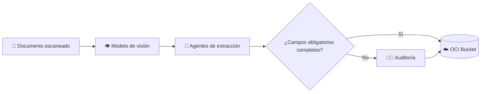
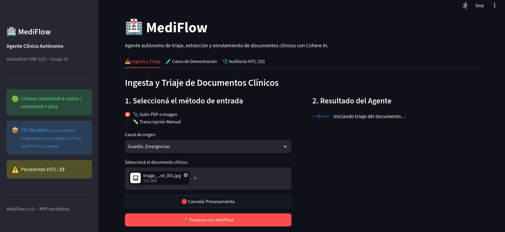
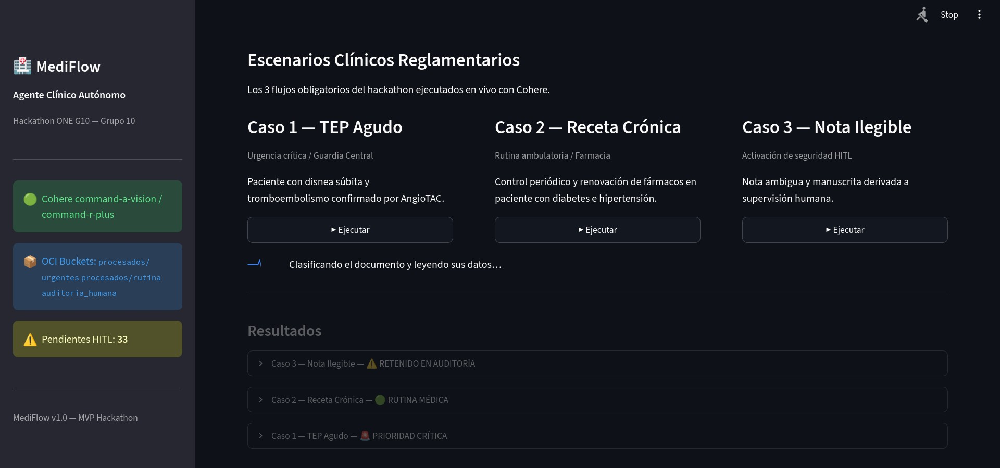
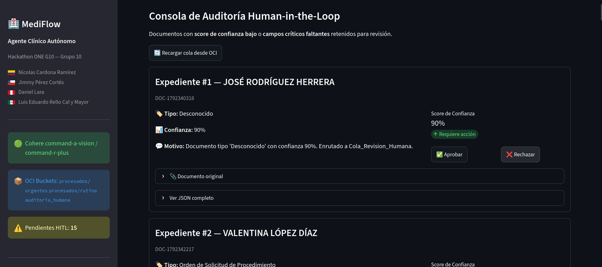

<div align="center">


# G10-LATAM-EQUIPO-40

**Agente Autónomo para Triaje, Extracción y Enrutamiento de Documentos Clínicos**


</div>

---

<div align="center">

### 🚀 **¡Prueba la aplicación en vivo!**

Puedes acceder directamente a la interfaz de usuario desplegada aquí:

### 👉 🌐 **[Abrir Aplicación - G10 LATAM](https://bring-knitting-champions-such.trycloudflare.com/)** 🌐 👈

</div>

---

## 🔑 Características clave

- **Extracción con visión**: lee imágenes escaneadas directamente
- **Validación estricta**: un campo obligatorio faltante envía el documento a **Auditoría**
- **Humano en el ciclo(HITL)**: pestaña de Auditoría con contador de pendientes
- **Almacenamiento en la nube**: OCI Object Storage

---

## 🏗️ Arquitectura



---

## 🖥️ Interfaz de Usuario y Experiencia Clínica (Streamlit)

**Desarrollado por:** Jimmy (Frontend & Conexión)

La interfaz de **MediFlow** fue construida como un panel interactivo de salud (*HealthTech*) sobre **Streamlit**, enfocado en la usabilidad del personal médico y auditores clínicos. Se estructura en tres módulos operativos diseñados para cubrir el ciclo completo de procesamiento y la evaluación del jurado:

---

### 1. Ingesta y Triaje Clínico en Vivo
Módulo de recepción multimodal que permite ingresar documentos mediante subida de archivos (PDF/Imagen) o transcripción de texto directa[cite: 3]. Conecta en tiempo real con el agente autónomo para clasificar la prioridad, identificar entidades clínicas (médico, paciente, diagnóstico CIE-10) y confirmar la persistencia en los buckets de OCI Object Storage Always Free[cite: 3].


*Captura de la vista de recepción de documentos y clasificación automática en MediFlow.*[cite: 3]

---

### 2. Demostración de Escenarios de Evaluación
Espacio preconfigurado con los tres flujos reglamentarios del Hackathon para permitir una auditoría rápida y repetible durante las presentaciones y el video de entrega[cite: 1]:
* **Caso 1 (Urgencia Crítica):** Tromboembolismo Pulmonar Agudo (TEP) con enrutamiento prioritario a Guardia[cite: 1].
* **Caso 2 (Rutina Ambulatoria):** Receta de tratamiento crónico validada y derivada a Farmacia.
* **Caso 3 (Documento Ambiguo):** Orden médica con datos borrosos o firma ilegible para activación de contingencia.


*Selector interactivo de escenarios de prueba con ejecución determinista.*[cite: 1]

---

### 3. Panel de Auditoría Clínica (Human-in-the-Loop)
Consola de supervisión para el patrón de diseño *Human-in-the-Loop* (HITL)[cite: 2]. Retiene automáticamente cualquier documento cuyo índice de confianza sea inferior a **0.85** o presente inconsistencias estructurales, permitiendo al especialista revisar el motivo de retención, inspeccionar los datos dudosos y autorizar o rechazar el documento con un clic[cite: 2].


*Módulo de control de calidad médica para casos derivados a revisión manual.*[cite: 2]

---

### ⚙️ Instrucciones de Ejecución del agente MediFlow

#### Requisitos previos

Se necesita tener instalado **[uv](https://docs.astral.sh/uv/)**, el gestor de paquetes y entornos de Python que usa el proyecto.

**Instalación de uv**

- **Windows (PowerShell):**

  ```powershell
  powershell -ExecutionPolicy ByPass -c "irm https://astral.sh/uv/install.ps1 | iex"
  ```

- **Linux / macOS:**

  ```bash
  curl -LsSf https://astral.sh/uv/install.sh | sh
  ```

- **Alternativa (cualquier SO, si ya tienes pip):**

  ```bash
  pip install uv
  ```

Verifica la instalación (si no reconoce el comando, reinicia la terminal):

```bash
uv --version
```

#### Ejecución en entorno local

```bash
# 1. Clonar el repositorio y ubicarse en la raíz
git clone https://github.com/No-Country-simulation/G10-LATAM-EQUIPO-40.git
cd G10-LATAM-EQUIPO-40

# 2. Instalar dependencias con uv
uv sync

# 3. Preparar variables de entorno
#    Crea tu archivo .env con tus credenciales y API key de Cohere,
#    guiándote con el archivo .env.example

# 4. Iniciar la aplicación
uv run streamlit run streamlit_app.py
```

#### Uso con buckets propios de Oracle Cloud Infrastructure

Para usar tus propios buckets de OCI, genera las credenciales con:

```bash
oci setup config
```
---

## 👤 Autores

- **Nicolas Cardona Ramirez**, desarrollador en Colombia 🇨🇴 · [LinkedIn](https://www.linkedin.com/in/nicolas-c-53144a101) · [GitHub](https://github.com/ncardona198)
- **Jimmy Pérez Cortés**, desarrollador en Chile 🇨🇱 · [LinkedIn](http://www.linkedin.com/in/jimmy-p%C3%A9rez-cort%C3%A9s-ba700587) · [GitHub](https://github.com/JimmyUC82)
- **Daniel Lara**, desarrollador en Perú 🇵🇪 · [LinkedIn](https://linkedin.com/in/daniel-lara-mendoza) · [GitHub](https://github.com/Sts87)
- **Luis Eduardo Rello Cal y Mayor**, desarrollador en México 🇲🇽 · [LinkedIn](https://www.linkedin.com/in/luis-rello-cal-y-mayor-a77b07183/) · [GitHub](https://github.com/RelloMayor)


---

> ⚠️ Proyecto demostrativo, no es un dispositivo médico. No incluye datos reales de pacientes.

